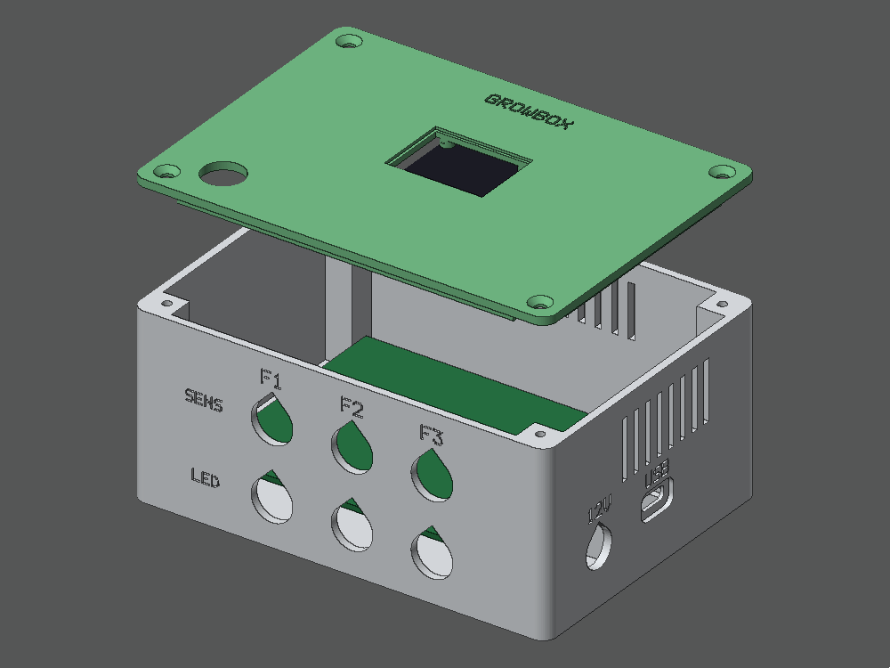
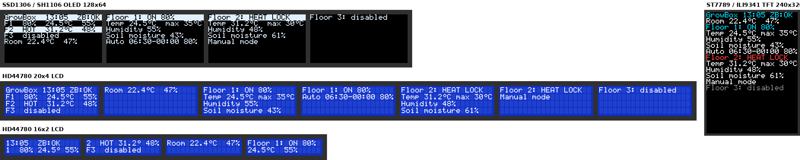
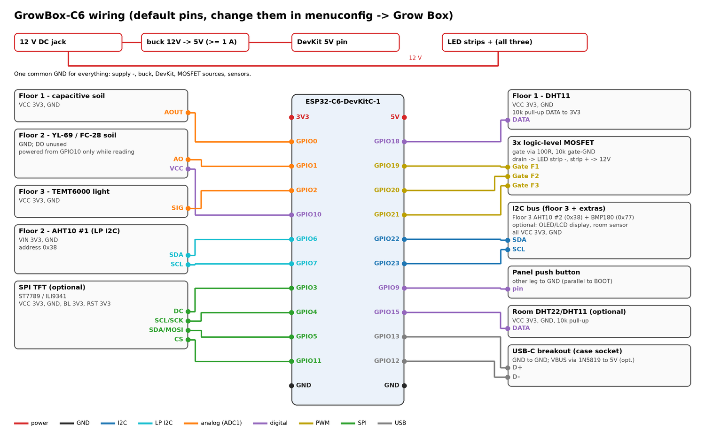

# GrowBox-C6

ESP32-C6 controller for a three-floor grow box. It runs one LED strip per floor on a schedule, cuts the light when a
floor gets too hot, and reads temperature, humidity, soil moisture, pressure and light. It shows everything on an
optional display, and can take time-lapse photos of the plants. It is a Zigbee device, controlled from Home
Assistant through Zigbee2MQTT.



**New here? Start with the [build guide](docs/GUIDE.md)**: parts, case, firmware, pairing, wiring, setup and
troubleshooting, step by step.

## Features

- **Per floor:**
  - Dimmable LED strip.
  - Schedule (on/off to the minute, brightness) or manual control.
  - Over-temperature cutoff with 2 °C hysteresis.
  - Enable/disable.
- **Sensors, chosen per floor in menuconfig:**
  - Temperature / humidity: DHT11, DHT22, AHT10 / AHT20, SHT3x, SHT4x, HTU21D / Si7021 or BME280.
  - Pressure: BMP180 or BMP280.
  - Soil moisture: capacitive or resistive.
  - Light: TEMT6000 or BH1750.
  - Each is optional. The defaults: floor 1 DHT11 + capacitive soil; floor 2 AHT10 + YL-69 soil; floor 3
    AHT10 + BMP180 + TEMT6000.
  - The build stops on pin or I2C address clashes and says which.
- **Fail-safe:**
  - A floor without its own temperature reading uses the hottest other floor.
  - If no temperature sensor gives a reading for 10 minutes, the lights go off.
  - A `sensor_fault` flag tells Home Assistant when a sensor stops answering.
- **Works offline:**
  - Settings live in the box.
  - The clock comes from Zigbee2MQTT and survives resets; only a power loss needs a new sync.
- **Display (optional):**
  - SSD1306 / SH1106 OLEDs, 16x2 / 20x4 LCDs (PCF8574 backpack), ST7789 / ILI9341 TFTs.
  - Pages rotate automatically, and the button switches pages.
- **Room sensor (optional):** a temperature + humidity sensor next to the box, which shows up in Home Assistant
  like any Zigbee climate sensor. Supported: DHT22, DHT11, AHT10 / AHT20, SHT3x, SHT4x, HTU21D / Si7021, BME280.
- **Cameras (optional):**
  - Up to three Arducam Mega SPI cameras.
  - Photos upload over Wi-Fi to a small server on your PC, which also makes the time-lapse videos.
- **Firmware updates over Zigbee,** with automatic rollback.
- **3D-printable case:** a lid for every display, cable glands per floor, a USB-C socket for flashing, and wall
  mounting ears.



## Documentation

| Document | Contents |
|---|---|
| [docs/GUIDE.md](docs/GUIDE.md) | **Build guide**: from parts to a running box |
| [docs/WIRING.md](docs/WIRING.md) | Every connection, pin by pin, other sensor choices, and cable suggestions |
| [case/README.md](case/README.md) | The case: printing, hardware, USB-C socket, mounting, changing sizes |
| [docs/CAMERAS.md](docs/CAMERAS.md) | Cameras on the GrowBox, the photo server and time-lapse videos |
| [docs/TIMELAPSE.md](docs/TIMELAPSE.md) | Alternative: separate ESP32-CAM boards on Wi-Fi |

## Quick start

For those who know ESP-IDF and Zigbee2MQTT. Everyone else: follow the [build guide](docs/GUIDE.md).

1. **Build and flash.** Needs ESP-IDF v6.0.

   ```bash
   idf.py set-target esp32c6
   idf.py menuconfig   # Grow Box: floor sensors, display, room sensor, pins, calibration, cameras
   idf.py build
   idf.py -p /dev/ttyACM0 flash monitor
   ```

2. **Install the converter.** Copy `z2m/growbox.mjs` to `<z2m data>/external_converters/`.
3. **Allow it.** Make sure Zigbee2MQTT's `configuration.yaml` has:

   ```yaml
   advanced:
     enable_external_js: true
   ```

   New installs write `false` there, and then the converter is ignored.
4. **Pair.** Restart Zigbee2MQTT, enable *Permit join*, and power the box. To pair it again later, hold the button
   for 10 s.

## Hardware at a glance



Default pins with the default sensors (all changeable in `idf.py menuconfig` → *Grow Box*):

| Function | GPIO | Notes |
|---|---|---|
| Floor 1 DHT11 data | 18 | 10 kΩ pull-up |
| Floor 1 capacitive soil AOUT | 0 | ADC |
| Floor 2 YL-69 AO / VCC | 1 / 10 | VCC is switched: powered only while reading |
| Floor 2 AHT10 SDA / SCL | 6 / 7 | LP I2C bus, fixed pins |
| Floor 3 AHT10 + BMP180 SDA / SCL | 22 / 23 | Main I2C bus, also for the display and room sensor |
| Floor 3 TEMT6000 SIG | 2 | ADC |
| LED PWM floor 1 / 2 / 3 | 19 / 20 / 21 | Logic-level MOSFET gate (100 Ω, 10 kΩ pull-down) |
| Button | 9 | DevKit BOOT button, plus the lid button |
| USB-C socket D+ / D− | 13 / 12 | The ESP32-C6's built-in USB |
| TFT SCK / MOSI / CS / DC | 4 / 5 / 11 / 3 | Only with a TFT |
| Room sensor (DHT) | 15 | Only with a DHT room sensor |

**Power:**
- A 12 V supply feeds the strips.
- A buck converter set to 5.0 V feeds the DevKit's 5V pin.
- Use **logic-level** MOSFETs (IRLZ44N, IRLB8721, AO3400). IRF520 modules only half switch on at 3.3 V.

The suggested perfboard layout is in [the build guide](docs/GUIDE.md#6-build-the-controller-board).

## Zigbee2MQTT and Home Assistant

The device is `GrowBox-C6` by GrowBoxDIY. Properties have the floor as a suffix (`_floor1` … `_floor3`); the room
sensor's use `_room`. Readings only appear for the sensors a floor has. After changing a floor's sensors and
flashing, click *Interview* and then *Reconfigure* on the device page.

| Kind | Properties |
|---|---|
| Light | `state_floorN`, `brightness_floorN` |
| Readings | `temperature_floorN`, `humidity_floorN`, `soil_moisture_floorN`, `pressure_floorN`, `illuminance_floorN`, `temperature_room`, `humidity_room`, `pressure_room` |
| Settings | `auto_mode_floorN`, `light_on_hour/minute_floorN`, `light_off_hour/minute_floorN`, `auto_brightness_floorN`, `max_temperature_floorN`, `enabled_floorN` |
| Status | `heat_lock_floorN`, `sensor_fault_floorN`, `time_synced` |
| Cameras | `take_photo_floorN` |

Behavior:
- Any manual light command switches the floor to manual mode. Turning `auto_mode` on hands the light back to the
  schedule.
- While a floor is disabled or heat-locked, ON is refused and the light shows OFF again.
- Out-of-range setting writes are rejected.

**Router or end device:**
- By default the box joins as a Zigbee **router** and relays for other devices.
- With cameras it must be an **end device** (menuconfig: *Component config → Zigbee → Zigbee Device Type*), because
  Wi-Fi and a Zigbee router don't share the radio well. See [docs/CAMERAS.md](docs/CAMERAS.md).

## Firmware updates over Zigbee

1. Bump `PROJECT_VER` in `CMakeLists.txt` (e.g. `2.0.0` → `2.0.1`) and build.
2. Copy `build/growbox.ota` and `build/growbox_ota_index.json` into the Zigbee2MQTT data directory.
3. In `configuration.yaml`:

   ```yaml
   ota:
     zigbee_ota_override_index_location: growbox_ota_index.json
   ```

4. Restart Zigbee2MQTT, then *OTA → Check for update → Update*.

The lights keep running during the update. The new firmware has to join the network (or run for 10 minutes);
otherwise the next reset rolls back to the previous version.

**Coming from the old single-app firmware:**
- **One USB flash needed.** The partition table now has two app slots, so flash once over USB with `idf.py flash`.
- **Nothing is lost.** Settings and the Zigbee network survive: `nvs` keeps its place, and the old settings format
  is migrated.
- **Start a new `sdkconfig`.** `sdkconfig.defaults` sets `CONFIG_FREERTOS_HZ=1000` and rollback, but defaults
  only apply to a new `sdkconfig`. Delete your old one before building.

## Development

### Code layout

| Path | Contents |
|---|---|
| `main/` | Firmware: `main.c` (control loop), `sensors.c` (floor sensors from menuconfig), `sensor_dev.c` (sensor drivers), `zb_device.c` (Zigbee data model), `zb_ota.c`, `display.c` + `disp_*.c`, `camera.c` + `arducam.c` + `wifi_link.c`; `check_config.cmake` stops the build on pin and I2C address clashes |
| `components/growbox_logic` | Schedule, cutoff, sensor math and decoding, OTA file parser. No ESP-IDF dependencies. |
| `components/growbox_ui` | Display pages as text grids, 5x7 font. No ESP-IDF dependencies. |
| `z2m/growbox.mjs` | Zigbee2MQTT converter |
| `tools/` | `make_ota_image.py` (Zigbee OTA file), `photo_server.py` (photo server and time-lapse) |
| `test/host/` | Unit tests, and `ui_preview`, which renders every display page to images |
| `test/config/` | Configuration checks: runs `check_config.cmake` on good and broken sensor setups |
| `test/z2m/` | Loads the converter with the real zigbee-herdsman-converters and checks exposes, configure and reports |
| `case/` | Case generator (`growbox_case.py`), STLs, previews |
| `docs/` | Guides; `make_wiring_diagram.py` and `make_board_layout.py` redraw the images |

### Tests

```bash
cmake -S test/host -B build-host && cmake --build build-host && ctest --test-dir build-host --output-on-failure
```

Configuration and converter checks (need `pip install esp-idf-kconfig` and Node.js):

```bash
python test/config/check_configs.py
npm install --no-save --ignore-scripts zigbee-herdsman-converters@26.125.0 && node test/z2m/test_converter.mjs
```

CI (`.github/workflows/build.yml`) runs:
- the host tests, the configuration checks and the converter test;
- the case collision check;
- a firmware build for every display type and for the camera setups, with a mix of floor and room sensors.

Each firmware build is uploaded as an artifact.
