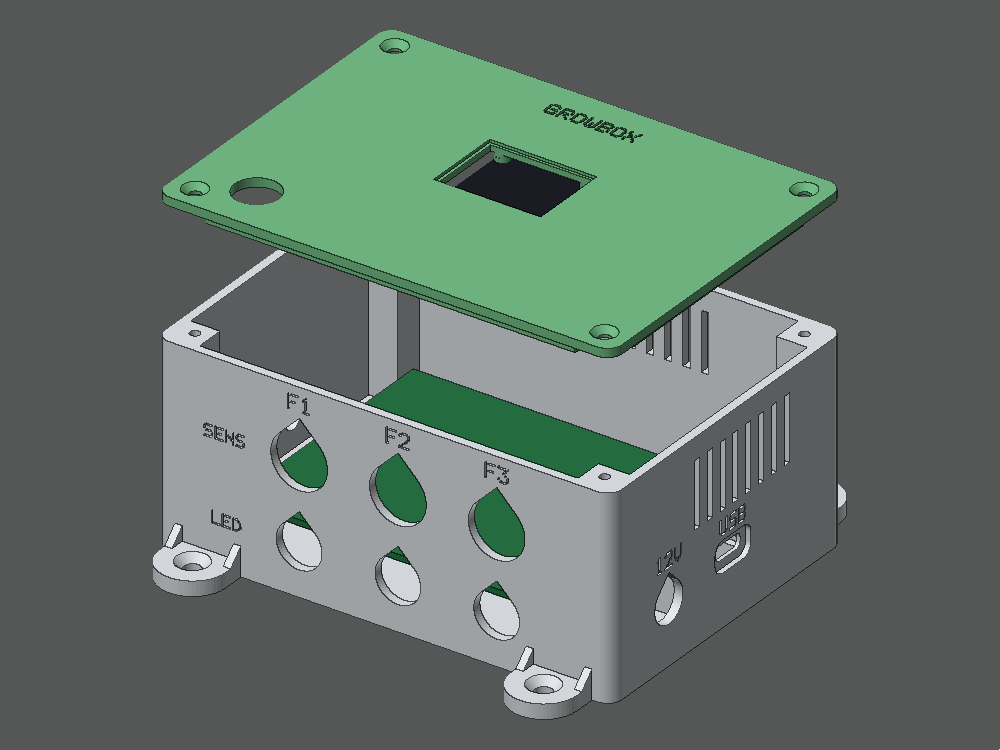
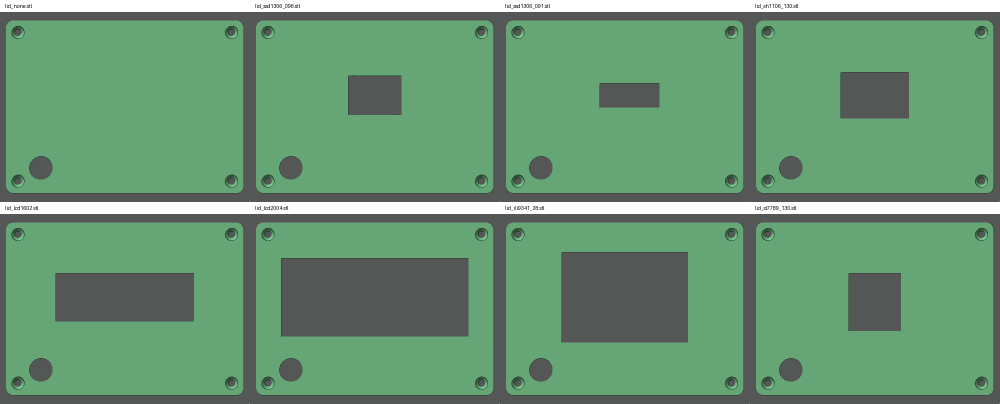
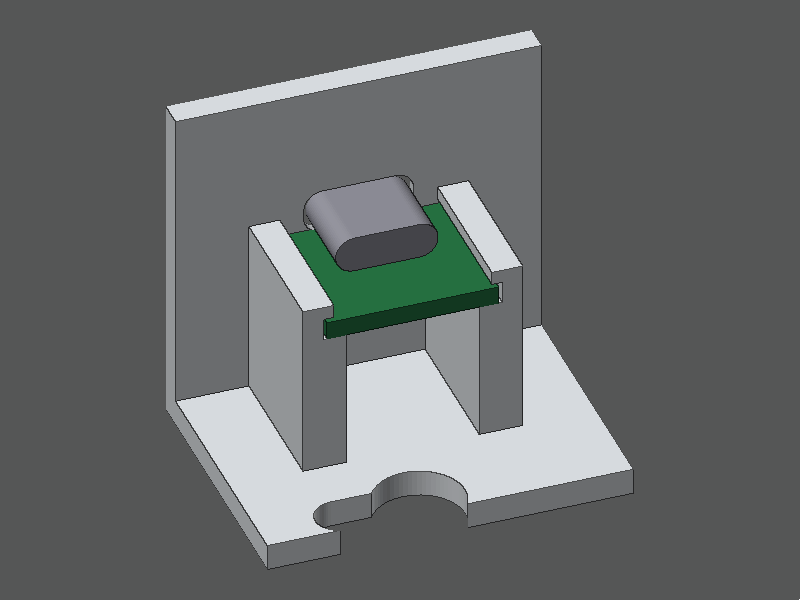

# Enclosure

3D-printable case for the controller: a box for the electronics and a lid for each display type. The box is
about 125 x 91 x 57 mm (L x W x H) with the lid on, and 121 mm tall including the mounting ears.



| Part | File |
|---|---|
| Box | `stl/base.stl` |
| Lid, no display | `stl/lid_none.stl` |
| Lid, SSD1306 0.96" 128x64 OLED | `stl/lid_ssd1306_096.stl` |
| Lid, SSD1306 0.91" 128x32 OLED | `stl/lid_ssd1306_091.stl` |
| Lid, SH1106 1.3" 128x64 OLED | `stl/lid_sh1106_130.stl` |
| Lid, 16x2 LCD + I2C backpack | `stl/lid_lcd1602.stl` |
| Lid, 20x4 LCD + I2C backpack | `stl/lid_lcd2004.stl` |
| Lid, ILI9341 2.8" TFT (landscape) | `stl/lid_ili9341_28.stl` |
| Lid, ST7789 1.3" 240x240 TFT | `stl/lid_st7789_130.stl` |



## Layout

- **Inside:** a standard **7 x 9 cm perfboard** on four M2 standoffs. It carries:
  - the ESP32-C6 DevKit in the top-left corner, with its USB-C end at the board's left edge;
  - the three MOSFETs;
  - the 12 V to 5 V buck converter;
  - screw terminals or JST connectors for the sensors.
- **Bottom wall:** 6 cable holes, labeled F1 / F2 / F3, two per floor.
  - Lower hole: the LED strip cable, 12.5 mm for a PG7 gland or a GX12 aviation connector.
  - Upper hole: the sensor cable, 15.5 mm for a PG9 gland, which takes a cable up to 8 mm (e.g. 12 cores for
    sensors plus a camera).
- **Left wall:** low vents, and a 6 mm hole for the optional room sensor's cable. The sensor itself goes on
  the outside, below the vents, so the electronics don't warm it (see `docs/WIRING.md`).
- **Right wall:** DC power jack (12V), a flush USB-C socket for flashing and logs (see below), and high vents.
- **Top wall:** vents.
- **DC jack hole:** 11 mm for the plastic DC-022 5.5x2.1 jack, 8 mm for DC-099 metal jacks (`DC_JACK_D`).
- **Lid:** display window and mounts, and a 12 mm momentary push button wired in parallel to the DevKit's BOOT
  button (GPIO9 to GND). Short press: next page. Hold 10 s: Zigbee reset.
- **Mounting ears:** four ears flush with the back, two on the top edge and two on the bottom edge, with
  countersunk holes for 4 mm wood screws. They sit near the corners so the cable glands and plugs never block the
  screwdriver; the fit check verifies that. Mount the box with the cable holes pointing down. To fix it:
  1. Hold the box in place and mark the four holes.
  2. Pre-drill 2.5-3 mm.
  3. Screw it on.
  - **Fabric grow tent:** pull zip ties through the ear holes and around a tent pole.
  - **Hanging instead:** the back also has two keyholes (screw heads up to 7.5 mm).

## USB-C socket

The socket is a small **USB-C breakout board**: the 16-pin type, about 15 x 13 mm, with the two 5.1 kΩ CC
resistors so USB-C chargers and laptops recognize it.
- **Mounting:** it slides into the cradle behind the right wall until the socket pokes into the wall opening. A
  dab of hot glue at the back keeps it there.
- **Plug pocket:** the wall is thinned around the opening so a cable plug goes in all the way.
- **Different board size:** change `USBC_BOARD`.



It connects to the ESP32-C6's built-in USB (USB Serial/JTAG), so it flashes and shows logs like the DevKit's own
port. No extension cable is needed: there is no room for a plug in front of the DevKit.

| Breakout pin | DevKit pin |
|---|---|
| GND | GND |
| D+ (DP) | GPIO13 |
| D- (DN) | GPIO12 |
| VBUS | 5V through a Schottky diode (1N5819, stripe toward 5V) — optional |

Notes:
- **Plug orientation:** if the breakout has separate DP1/DP2 and DN1/DN2 pads, join DP1 with DP2 and DN1 with
  DN2, so the plug works both ways round.
- **VBUS:** with the diode, the board can be flashed from the laptop alone, and the box's own 5 V can't push current
  back into the laptop. Without it, power the box from 12 V while flashing.
- **The DevKit's own USB ports:** don't use them at the same time.
- **Flashing:** `idf.py -p /dev/ttyACM0 flash monitor` (`COMx` on Windows).

To get the old open slot to the DevKit's own ports instead, set `USB_PORT = "open"`.

## Printing

- PETG is recommended (grow tents are warm and humid); PLA works away from heat.
- 0.2 mm layers, 3 walls, 20 % infill.
- **No supports:** the STLs are already in print orientation. The box prints open side up, and the wall holes are
  teardrops. The lid prints outer face down.

## Hardware

| Qty | Part |
|---|---|
| 4 | M3 x 10-12 countersunk self-tapping screws (lid). For M3 heat-set inserts set `SCREW_PILOT_D = 4.0`. |
| 4 | 4 x 20 mm countersunk wood screws (mounting ears) |
| 4 | M2 x 5 self-tapping screws (perfboard) |
| 4 | Display screws: M2 for the 0.96" OLED, M2.5 for the 1.3" OLED, M3 for the LCDs and the 2.8" TFT. The 0.91" OLED and the 1.3" ST7789 have no holes: they sit in corner guides; fix them with a dab of hot glue. |
| 3 + 3 | PG7 glands (LED cables) and PG9 glands (sensor/camera cables) |
| 1 | 5.5x2.1 panel DC jack |
| 1 | USB-C female breakout board, 16-pin with CC resistors (about 15 x 13 mm) |
| 1 | 1N5819 Schottky diode (optional, for flashing without 12 V) |
| 1 | 12 mm momentary push button |

## Check your display before printing

The display presets are typical module sizes, and modules vary between sellers. Measure yours and compare with
`DISPLAYS` in `growbox_case.py`:
- `pcb`: board size.
- `holes`: mounting hole positions from the board center.
- `glass`: size of the glass or LCD frame.
- `glass_h`: height of the glass front above the PCB.

Then regenerate:

```bash
pip install manifold3d numpy
python case/growbox_case.py --check            # writes case/stl/*.stl
python case/growbox_case.py --check --display lcd2004
```

`--check` builds simple models of the parts inside (perfboard and components, glands, DC jack, button, display
module and glass, the USB-C breakout and a plugged-in cable, the glands and plugs outside the box, and a
screwdriver over every mounting hole). It reports any that hit each other or the case, so a changed parameter can't silently produce a
box that doesn't close. `python case/render_preview.py` (needs Pillow) redraws the images here.

Everything else is a parameter at the top of `growbox_case.py`: box size, wall thickness, hole sizes and
positions, perfboard position, mounting ears (`EARS = False` removes them).
