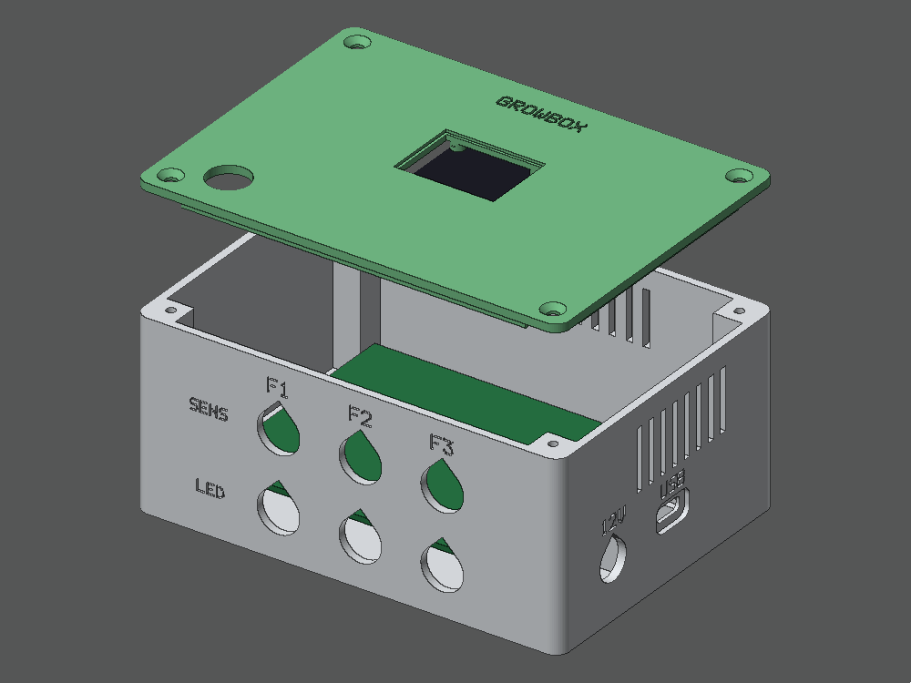
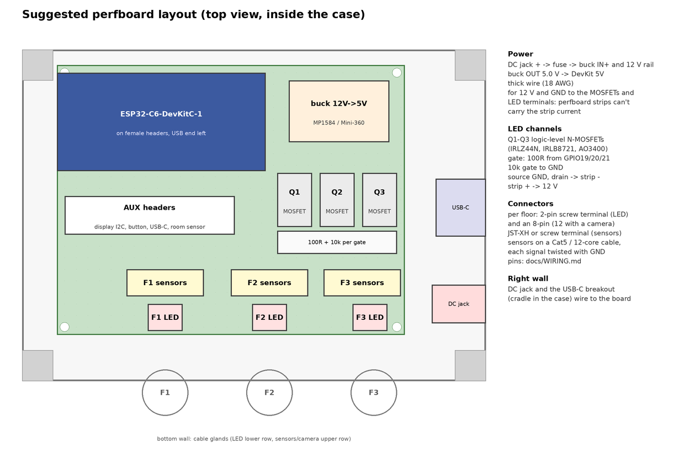
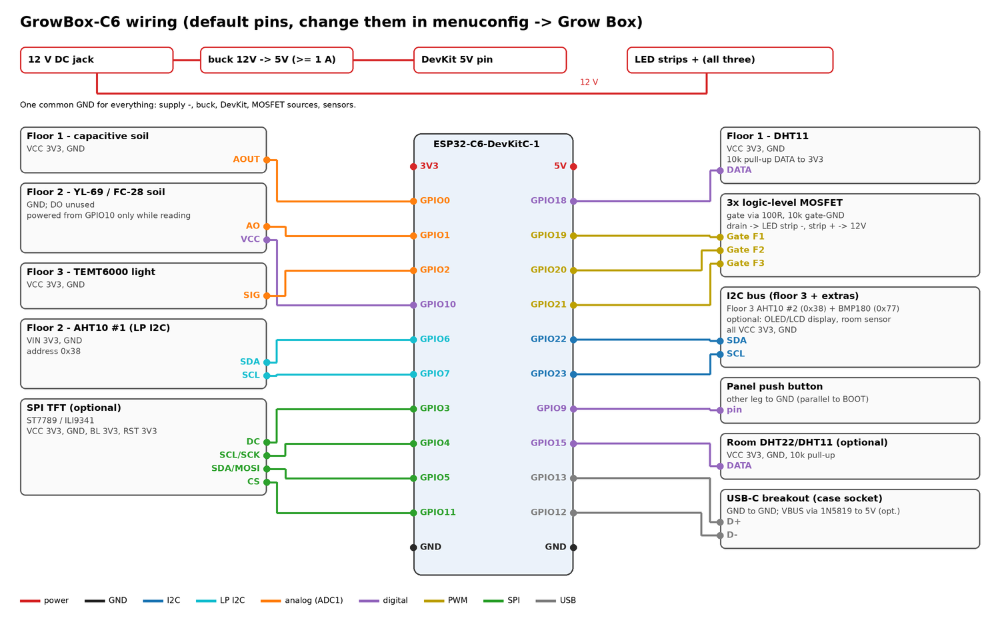
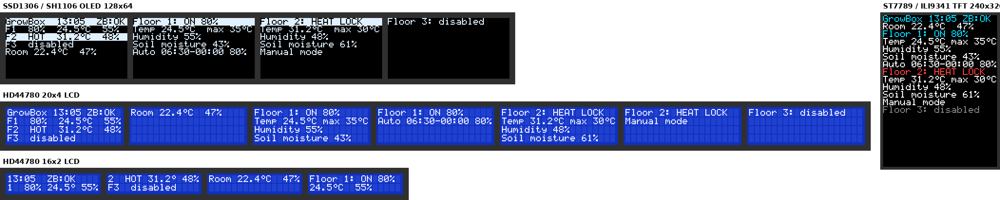

# Build guide

This guide takes you from a pile of parts to a grow box running in Home Assistant. It covers parts, the case, the
firmware, Zigbee pairing, the controller board, the cables to the floors, and setup.

Work through it in order. You flash and pair the bare DevKit first, before soldering anything. That way you know
the board, the toolchain and Zigbee2MQTT all work before the hardware work starts.

1. [Parts and tools](#1-parts-and-tools)
2. [Print the case](#2-print-the-case)
3. [Install ESP-IDF and build the firmware](#3-install-esp-idf-and-build-the-firmware)
4. [Flash the bare DevKit](#4-flash-the-bare-devkit)
5. [Pair with Zigbee2MQTT](#5-pair-with-zigbee2mqtt)
6. [Build the controller board](#6-build-the-controller-board)
7. [Power checks](#7-power-checks)
8. [Sensors and cables to the floors](#8-sensors-and-cables-to-the-floors)
9. [Close the case and mount it](#9-close-the-case-and-mount-it)
10. [Set up in Home Assistant](#10-set-up-in-home-assistant)
11. [Calibrate the soil sensors](#11-calibrate-the-soil-sensors)
12. [Optional: display, button, room sensor, cameras](#12-optional-display-button-room-sensor-cameras)
13. [Firmware updates](#13-firmware-updates)
14. [Troubleshooting](#14-troubleshooting)

---

## 1. Parts and tools

### Controller

| Qty | Part | Notes |
|---|---|---|
| 1 | **ESP32-C6-DevKitC-1** | The case is made for this board. |
| 1 | 12 V power supply | Add up the strips' watts, divide by 12 for amps, then add 0.5 A. Example: three 15 W strips → 3.75 A + 0.5 A → a 5 A supply. |
| 1 | Buck converter, 12 V → 5 V, 1 A or more | MP1584, Mini-360 or LM2596 module. |
| 1 | Inline fuse holder and fuse | About 1.25 × the strips' current, e.g. 5 A for 3.75 A of strips. |
| 3 | **Logic-level N-MOSFETs** | IRLZ44N or IRLB8721 (TO-220), or AO3400 for strips under 3 A. **Not** IRF520 modules: see [WIRING.md](WIRING.md#led-strips-one-channel-per-floor). |
| 3 | 100 Ω resistors | MOSFET gates |
| 3 | 10 kΩ resistors | Gate pull-downs, so the lights stay off while the ESP32 boots |
| 1 | 7 x 9 cm perfboard | The standard size; the case is made for it. |
| 2 | Female header strips | As long as the DevKit's pin rows, so the DevKit plugs in and out |
| 3 | 2-pin screw terminals, 5 mm pitch | LED strip outputs |
| 3 | 8-pin screw terminals or JST-XH connectors | Sensor cables. Use 12-pin ones if a floor gets a camera. |
| | Wire | 0.75 mm² (18 AWG) for 12 V and GND inside the box; thin solid wire for the signals |

### Sensors and lights (the default set)

| Floor | Parts |
|---|---|
| 1 | DHT11, capacitive soil sensor v1.2 or v2.0 |
| 2 | AHT10, YL-69 / FC-28 resistive soil sensor |
| 3 | AHT10, BMP180, TEMT6000 light sensor |
| each | 12 V LED strip or grow light bar |

Other sensors can work too, but the firmware expects these ones on these floors.

### Case and cables

- **Case hardware:** screws, glands, DC jack, USB-C breakout and button. The list is in
  [case/README.md](../case/README.md#hardware).
- **LED cables:** 2-core cable, 0.5 mm² for up to about 3 A, 0.75 mm² above that.
- **Sensor cables:** Cat5 / Cat6 network cable, one per floor.

### Optional

- **Display:** any of the supported OLEDs, LCDs or TFTs. See [section 12](#12-optional-display-button-room-sensor-cameras).
- **12 mm push button** for the lid.
- **Room sensor**, e.g. DHT22, SHT31 or BME280.
- **Up to 3 Arducam Mega SPI cameras**: see [CAMERAS.md](CAMERAS.md).

### Tools

- Soldering iron, solder, side cutters, wire stripper.
- **Multimeter.** You can't skip this one: you need it to set the buck converter.
- 3D printer, or a printing service.
- **USB-C data cable.** Some cheap cables only carry power and won't work for flashing.
- A computer with Linux, macOS or Windows.
- A Zigbee coordinator already running **Zigbee2MQTT** with Home Assistant.

---

## 2. Print the case

Start the print early; it takes a few hours.

1. Print `case/stl/base.stl`.
2. Print the lid that matches your display, e.g. `case/stl/lid_ssd1306_096.stl`, or `lid_none.stl` without a
   display.
3. Print settings: PETG, 0.2 mm layers, 3 walls, 20 % infill, **no supports**. The files are already in print
   orientation.

Display modules vary between sellers. Before you print a lid, measure your display and compare it with the
preset, as described in [case/README.md](../case/README.md#check-your-display-before-printing).



---

## 3. Install ESP-IDF and build the firmware

The firmware needs **ESP-IDF v6.0** (CI uses v6.0.3). The Zigbee library downloads automatically on the first
build.

### Install ESP-IDF

**Linux / macOS:**

1. Install the prerequisites. On Debian / Ubuntu:

   ```bash
   sudo apt install git wget flex bison gperf python3 python3-pip python3-venv cmake ninja-build ccache libffi-dev libssl-dev dfu-util libusb-1.0-0
   ```

   For macOS, see
   [Espressif's guide](https://docs.espressif.com/projects/esp-idf/en/stable/esp32c6/get-started/index.html).

2. Get ESP-IDF and its tools:

   ```bash
   mkdir -p ~/esp && cd ~/esp
   git clone -b v6.0.3 --recursive https://github.com/espressif/esp-idf.git
   cd esp-idf && ./install.sh esp32c6
   ```

3. Load the environment. Do this **in every new terminal** before using `idf.py`:

   ```bash
   . ~/esp/esp-idf/export.sh
   ```

4. **Linux only:** let your user open serial ports, then log out and back in:

   ```bash
   sudo usermod -aG dialout $USER
   ```

**Windows:**
- Install ESP-IDF v6.0.x with Espressif's installer, following
  [Espressif's guide](https://docs.espressif.com/projects/esp-idf/en/stable/esp32c6/get-started/index.html).
- Use the ESP-IDF terminal it creates. That terminal already has `idf.py` set up.

**VS Code:** instead of the command line, you can use the *ESP-IDF* extension by Espressif. It installs ESP-IDF
for you and has buttons for build, flash and monitor. The steps below still apply; the extension just runs the
same commands.

### Get the code and configure it

```bash
git clone https://github.com/mejgan/esp32_ha_grow.git
cd esp32_ha_grow
idf.py set-target esp32c6
idf.py menuconfig
```

Run `set-target` first: it resets `sdkconfig`, so running it after `menuconfig` throws your settings away.

**Using menuconfig:**

| Key | Action |
|---|---|
| Arrow keys and Enter | Move around |
| Space | Toggle an option |
| `/` | Search |
| `S` | Save |
| `Q` | Quit |

All project settings are under **Grow Box**:

| Menu | What to set now |
|---|---|
| *Display* | Your display type, or *None*. TFTs also need size and rotation; see [section 12](#display). |
| *Room sensor* | Your room sensor, or *None*. |
| *Button* | Leave GPIO9. That's the DevKit's BOOT button and the lid button. |
| *Default settings* | Light on/off hours, brightness and max temperature for the first boot. You can change all of these later from Home Assistant. |
| *Floor N pins* | Leave the defaults, unless you wire differently. |
| *Soil sensor calibration* | Leave for now; see [section 11](#11-calibrate-the-soil-sensors). |
| *Cameras* | Only with cameras; see [CAMERAS.md](CAMERAS.md#firmware-setup). |

Settings take effect only after a rebuild and flash. To change something later, run `idf.py menuconfig` again
and flash again.

### Build

```bash
idf.py build
```

The first build takes several minutes. It ends with `Project build complete` and the flash command.

---

## 4. Flash the bare DevKit

Flash the DevKit on its own, before it goes on the board. Nothing else should be connected yet.

1. Plug the DevKit into the computer. Either of its two USB-C ports works:
   - *UART*: a USB-to-serial chip;
   - *USB*: the ESP32-C6's own USB.
2. Find the port.
   - **Linux:** `ls /dev/ttyACM* /dev/ttyUSB*`. It's usually `/dev/ttyACM0` or `/dev/ttyUSB0`.
   - **macOS:** `ls /dev/cu.usb*`.
   - **Windows:** the `COM` number in Device Manager → Ports.
3. Flash it and watch the log:

   ```bash
   idf.py -p /dev/ttyACM0 flash monitor
   ```

   Press **Ctrl+]** to leave the monitor.

4. **If it says `Failed to connect`:**
   1. Hold **BOOT**.
   2. Tap **RESET**.
   3. Release BOOT.
   4. Run the command again.

On first boot the log shows:

```
zb_device: Factory new, start network steering (enable Permit join in Zigbee2MQTT)
```

It keeps retrying until it joins a network, so leave it running and go on to pairing. The floor sensors aren't
connected yet, so warnings about them are normal.

---

## 5. Pair with Zigbee2MQTT

### Install the converter (once)

Zigbee2MQTT needs a small converter file to know this device. It's `z2m/growbox.mjs` in this repository.

1. **Find the Zigbee2MQTT data folder.** It's the folder that contains `configuration.yaml`:
   - **Home Assistant add-on:** the add-on's data folder, by default `/config/zigbee2mqtt`. Open it with the
     *File editor*, *Studio Code Server* or *Samba* add-on.
   - **Docker:** the folder mounted at `/app/data`.
   - **Plain install:** `data/` in the Zigbee2MQTT folder.
2. **Copy the file.** Create a folder `external_converters` there and copy `growbox.mjs` into it:
   `<data>/external_converters/growbox.mjs`.
3. **Allow external converters.** Open `configuration.yaml` and make sure it has:

   ```yaml
   advanced:
     enable_external_js: true
   ```

   New installs write `enable_external_js: false`; with that setting the converter is silently ignored.
   If there's already an `advanced:` section, add the line inside it rather than adding a second `advanced:`.
4. **Restart Zigbee2MQTT.** Its log should mention `growbox.mjs`.

### Pair

1. In the Zigbee2MQTT web interface, click **Permit join (All)**.
2. Power the DevKit, if it isn't already running from step 4.
3. Within a minute, `GrowBox-C6` (vendor GrowBoxDIY) shows up and the interview finishes. The ESP32 log shows
   `Joined network successfully` and a moment later `time synced: local HH:MM:SS`.
4. Give it a friendly name such as `growbox`. Entity names in Home Assistant follow that name.
5. Turn *Permit join* off again.

**If the device shows as *Unsupported* or has no controls,** the converter isn't loaded:
1. Check the file location and `enable_external_js`.
2. Restart Zigbee2MQTT.
3. On the device page, click **Reconfigure**.

**Router or end device?** The firmware joins as a Zigbee **router** by default. It's mains-powered, so it also
relays for other devices. With cameras it has to be an **end device** instead. An end device needs a coordinator
or a router (for example a Zigbee smart plug) within reach of the box. See [CAMERAS.md](CAMERAS.md).

**Time:** the clock comes from Zigbee2MQTT. It's the local time of the machine running Zigbee2MQTT, so check that
machine's time zone. In Docker, set the `TZ` environment variable, e.g. `TZ=Europe/Berlin`.

---

## 6. Build the controller board

Unplug the DevKit before you solder. Use this layout: it fits the case, and each floor's terminals line up with
that floor's cable glands.



The full pin-by-pin wiring is in **[WIRING.md](WIRING.md)**. This overview diagram shows all of it:



Order of work:

1. **DevKit headers.**
   - Solder the two female header strips so the DevKit plugs in with its USB end at the board's left edge (top-left
     in the picture).
   - Plug the DevKit in while soldering, so the strips line up. Then take it out again.
2. **Buck converter.**
   1. Before soldering it in, connect it to the 12 V supply.
   2. Turn its trimmer until the output reads **5.0 V** on the multimeter. Many modules come set to a higher
      voltage, which would kill the DevKit.
   3. Solder it in the top-right corner.
3. **Power wiring.** Use 0.75 mm² wire, soldered point to point. Perfboard pads and thin traces can't carry the
   strip current.

   ```
   DC jack + ── fuse ──┬── buck IN+
                       └── 12 V rail ── + of each LED terminal
   DC jack − ──────────┬── buck IN−
                       └── GND rail ── MOSFET sources, DevKit GND, sensor GND
   buck OUT+ (5.0 V) ───── DevKit 5V pin
   buck OUT− ───────────── GND rail
   ```

4. **MOSFETs**, one per floor (Q1–Q3). For IRLZ44N / IRLB8721 the pins are G-D-S from the left, with the text
   facing you.

   | MOSFET pin | Connect to |
   |---|---|
   | Gate | 100 Ω to GPIO19 / 20 / 21 (floor 1 / 2 / 3), and 10 kΩ from gate to GND |
   | Source | GND rail (thick wire) |
   | Drain | − of that floor's LED terminal (thick wire) |

5. **Sensor terminals**, one 8-pin terminal or JST-XH per floor, along the bottom edge. Wire each one to its DevKit
   pins and to 3V3 / GND as in [WIRING.md](WIRING.md):
   - Floor 1: 3V3, GND, GPIO18 (DHT11), GPIO0 (soil).
   - Floor 2: 3V3, GND, GPIO6 / GPIO7 (I2C), GPIO1 (soil), GPIO10 (soil power).
   - Floor 3: 3V3, GND, GPIO22 / GPIO23 (I2C), GPIO2 (light).

   Find the GPIO numbers on the labels printed next to the DevKit's pins. If your DHT11 is a bare 4-pin sensor
   (not on a small board), add a 10 kΩ pull-up from GPIO18 to 3V3 on the perfboard.
6. **AUX header** (optional): a pin header for the display (3V3, GND, SDA, SCL), the lid button, the USB-C
   breakout and the room sensor, so they plug in and out.
7. **DC jack and USB-C breakout.**
   1. Mount them in the right wall of the case.
   2. Wire them to the board with enough slack to open the case.
   3. Wire the USB-C breakout as in [case/README.md](../case/README.md#usb-c-socket):
      - D+ → GPIO13;
      - D− → GPIO12;
      - GND → GND;
      - VBUS → 1N5819 (stripe toward 5V) → 5V. This one is optional.

---

## 7. Power checks

Do these with the **DevKit unplugged** from its headers.

1. **No power yet.** With the multimeter on resistance or beep mode, check there's no short:
   - between the 12 V rail and GND;
   - between the 5V header pin and GND;
   - between the 3V3 header pin and GND.
2. **Connect 12 V.** Measure:
   - 12 V at each LED terminal's + (against GND);
   - **5.0 V** at the DevKit's 5V header pin;
   - 0 V at each LED terminal's − against GND, because the gates are pulled down.
3. **Unplug 12 V and plug the DevKit in.**
4. **Connect 12 V again.**
   - The DevKit's power LED lights.
   - Over the USB-C socket, the log runs as in step 4.
   - No part gets warm.

**USB and the 12 V supply:**
- With the optional diode, the case's USB-C socket can stay plugged in while the box runs on 12 V.
- Don't plug a cable into the DevKit's **own** USB ports while 12 V is connected. The DevKit isn't meant to be
  fed from its 5V pin and USB at the same time.

---

## 8. Sensors and cables to the floors

Use one Cat5 cable per floor. Run each signal in a pair with GND, as in the pair table in
[WIRING.md](WIRING.md#cables-to-the-floors). At the floor end, solder or crimp the sensor boards on and protect
the joints with heat-shrink.

| Floor | Sensors | Cable notes |
|---|---|---|
| 1 | DHT11, capacitive soil | Mount the DHT11 at plant height, out of direct light. |
| 2 | AHT10, YL-69 soil | The YL-69 gets power only while it reads, so the probe corrodes slowly. |
| 3 | AHT10, BMP180, TEMT6000 | The AHT10 and BMP180 share the I2C wires. |

General notes:
- **Sensor placement:** keep the temperature sensors out of the LED's direct light and heat, or the over-temperature
  cutoff trips early.
- **I2C cable length:** keep I2C cables under 2 m. If readings drop out, add 4.7 kΩ pull-ups (SDA and SCL to
  3V3) at the box end.
- **Soil sensors:** push the capacitive sensor in only up to its line. Electronics above the line must stay dry.
- **LED strips:** use 2-core cable. Connect strip + to the terminal's +, and strip − to the terminal's −.

**Test before closing the case:**
1. Power the box with the USB-C log open.
2. Every 30 s the log prints one line per floor:

   ```
   sensors: floor 1: temp ok 24.0C | hum ok 55.0% | soil ok 1980mV (51.4%)
   ```

3. Every value should say `ok`. `ERR` means that sensor isn't answering; check its wires.

---

## 9. Close the case and mount it

1. **Glands.**
   - Put the cables through the glands: LED cables in the lower row, sensor cables in the upper row.
   - Connect them to the terminals.
   - Tighten the glands, leaving some slack inside.
2. **Board.**
   - Fix the perfboard on the four standoffs with M2 screws.
   - Check that no wire is pinched under it.
3. **Lid.**
   - Fix the display and button in the lid; see [section 12](#12-optional-display-button-room-sensor-cameras).
   - Close the lid with four M3 screws.
4. **Mount.**
   - Mount the box with the **cable glands pointing down**, so water runs off.
   - Use 4 mm wood screws through the four ears, or zip ties around a tent pole.
   - Details are in [case/README.md](../case/README.md#layout).

---

## 10. Set up in Home Assistant

Zigbee2MQTT creates the Home Assistant entities by itself; nothing to set up in Home Assistant itself. On the
device page (*Settings → Devices & services → MQTT → GrowBox-C6*) you get, for each floor:

| Entity | Type | What it does |
|---|---|---|
| `light` floor N | light | On/off and brightness. Any manual command switches the floor to manual mode. |
| `auto_mode_floorN` | switch | ON: the schedule controls the light. |
| `light_on_hour/minute_floorN`, `light_off_hour/minute_floorN` | number | Schedule. Off before on means the window runs over midnight (e.g. 18:00 → 12:00). |
| `auto_brightness_floorN` | number | Brightness in auto mode, 1–100 %. |
| `max_temperature_floorN` | number | Over-temperature cutoff, 20–50 °C (2 °C hysteresis). |
| `enabled_floorN` | switch | OFF: the floor isn't used. Its light stays off and its sensors aren't read. |
| `temperature/humidity_floorN` | sensor | Floor climate |
| `soil_moisture_floor1/2` | sensor | Soil, 0–100 % after calibration |
| `pressure_floor3`, `illuminance_floor3` | sensor | From the BMP180 and TEMT6000 |
| `heat_lock_floorN` | binary | ON while the cutoff holds the light off |
| `sensor_fault_floorN` | binary | ON while a sensor on that floor gives no reading |

For the whole device there is also:
- `time_synced`;
- with a room sensor: `temperature_room`, `humidity_room` and `pressure_room`;
- with cameras: a `take_photo` switch per floor;
- the firmware update entity.

**Typical setup for each floor in use:**
1. Set the schedule, e.g. on 06:00, off 00:00 for 18/6.
2. Set `auto_brightness` and `max_temperature`.
3. Turn `auto_mode` on.

**Good to know:**
- Settings are saved in the box and keep working without the network. Only the clock needs Zigbee2MQTT, and only
  after a power loss.
- While a floor is heat-locked or disabled, turning it ON is refused and the light shows OFF again.
- After a power loss, auto mode keeps the lights off until the clock is synced again, which takes a few seconds once
  Zigbee2MQTT is reachable.
- Ideas for automations: notify on `heat_lock` or `sensor_fault`; water when `soil_moisture` drops below a level.
- The TEMT6000 tops out at about 600 lx with this circuit, so under grow lights `illuminance_floor3` sits at the
  maximum. It still tells you whether the light is on.

---

## 11. Calibrate the soil sensors

Do this with the final cable in place, because cable length shifts the readings a little.

1. **Read the dry value.** Open the log (`idf.py -p PORT monitor`) and note the `mV` value of the soil sensor
   held in dry air. Example: `soil ok 2750mV`.
2. **Read the wet value.** Put the sensor in a glass of water, up to its line, and note the value again.
3. **Enter both values.** In `idf.py menuconfig` → *Grow Box → Soil sensor calibration*, enter the dry and wet
   values for that sensor.
   - Floor 1: capacitive.
   - Floor 2: YL-69.
4. Build and flash again.

Both sensors read lower in water than in dry air. The firmware maps the dry value to 0 % and the wet value to
100 %.

---

## 12. Optional: display, button, room sensor, cameras

### Display



- **Pages:** they rotate every few seconds; set the time in *Grow Box → Display → Seconds per page*. Press the
  button for the next page.
- **Lid:** the case has a lid for each display.
- **Wiring:** in [WIRING.md](WIRING.md#display-optional).

| Display | Wiring | Notes |
|---|---|---|
| SSD1306 / SH1106 OLED | 3V3, GND, SDA GPIO22, SCL GPIO23 | Address 0x3C / 0x3D found automatically. Picture shifted by 2 pixels or noisy at the right edge: pick SH1106 instead of SSD1306 (common on 1.3" boards). |
| 16x2 / 20x4 LCD + PCF8574 | **5V**, GND, SDA GPIO22, SCL GPIO23 | Remove the backpack's two pull-up resistors, because they pull the bus to 5 V. Turn the blue trimmer if the screen stays blank or shows only blocks. |
| ST7789 / ILI9341 TFT | 3V3, GND, SCK GPIO4, MOSI GPIO5, CS GPIO11, DC GPIO3, RST and BL to 3V3 | Set the size and rotation. Wrong colors: toggle *Invert colors* and *BGR*. ST7789 without a CS pin: CS -1 and SPI mode 3. |

- **OLED burn-in:** to make the OLED last, set *Turn the display off after …* (e.g. 300 s). The button wakes it.
- **Font scale on TFTs:** with *Font scale* 2 at 240x320, everything fits on one page.

### Button

- **Wiring:** the lid button connects GPIO9 to GND, in parallel to the DevKit's BOOT button.
- **Short press:** next page.
- **Hold:** the display counts down; after **10 s** the box leaves the Zigbee network and starts pairing again.
- **At power-up:** don't hold the button while the box powers up. GPIO9 is a boot pin, so the ESP32 then waits
  for flashing instead of starting.

### Room sensor

A temperature + humidity sensor next to the box, outside the grow tent. In Home Assistant it shows up as
`temperature_room` / `humidity_room`, like a plain Zigbee climate sensor.

1. **Choose the sensor.** Pick it in *Grow Box → Room sensor*.
2. **Wire it.** Take it through the 6 mm hole in the left wall, as in [WIRING.md](WIRING.md#room-sensor-optional-next-to-the-controller).
3. **Mount it** outside the case, below the vents, so the electronics don't warm it.

### Cameras

Up to three Arducam Mega SPI cameras, one per floor.
- **Photos:** while a floor's light is on, its camera takes a photo every 30 minutes and uploads it over Wi-Fi to
  `tools/photo_server.py` on your PC. The server also makes the time-lapse videos.
- **Requirements:**
  - Zigbee **end device** mode, set in menuconfig.
  - **2.4 GHz** Wi-Fi. The ESP32-C6 has no 5 GHz.
  - Pairing again after switching from router mode.
- **Full guide:** [CAMERAS.md](CAMERAS.md).

---

## 13. Firmware updates

**Over USB:** any time, with `idf.py -p PORT flash`. Settings and pairing are kept.

**Over Zigbee**, without opening the case:

1. **Bump the version.** In `CMakeLists.txt`, raise `PROJECT_VER`, e.g. `2.0.0` → `2.0.1`, then run `idf.py
   build`.
2. **Copy two files** into the Zigbee2MQTT data folder:
   - `build/growbox.ota`;
   - `build/growbox_ota_index.json`.
3. **Point Zigbee2MQTT at the index.** Add this to `configuration.yaml`:

   ```yaml
   ota:
     zigbee_ota_override_index_location: growbox_ota_index.json
   ```

4. **Start the update.**
   1. Restart Zigbee2MQTT.
   2. Open the *OTA* page.
   3. Click *Check for update*, then *Update*.

How it behaves:
- **Lights:** they keep running during the update, which takes a while (often 10–30 minutes).
- **Automatic rollback:** the new firmware marks itself good once it joins the network or has run for 10 minutes.
  If it crashes before that, the next reset goes back to the old version.

---

## 14. Troubleshooting

| Problem | Fix |
|---|---|
| `Failed to connect` when flashing | Use a data cable. Hold BOOT, tap RESET, release BOOT, try again. On Linux, check the `dialout` group (step 3). |
| Box doesn't start when powered up | The lid button or BOOT is held or stuck: GPIO9 low at power-up means download mode. |
| Device doesn't appear in Zigbee2MQTT | Turn *Permit join* on. Move the box closer to the coordinator or a router. Hold the button 10 s to restart pairing. If Zigbee2MQTT still lists an old entry for it, remove that first. |
| *Unsupported* in Zigbee2MQTT | Converter not loaded. Check `advanced: enable_external_js: true` and `external_converters/growbox.mjs`, restart Zigbee2MQTT, then click *Reconfigure* on the device. |
| Lights stay off in auto mode | Check: `time_synced` is on, the time is inside the window, `enabled` is on, `heat_lock` is off. |
| Clock is off by some hours | Fix the time zone of the machine running Zigbee2MQTT (`TZ` in Docker). |
| Light refuses to turn on | The floor is heat-locked (too hot) or disabled. |
| Strip dim, MOSFET hot | Not a logic-level MOSFET: replace it (no IRF520). |
| Strips flash at power-up | The 10 kΩ gate pull-down is missing. |
| `temp ERR` / `sensor_fault` | Check the sensor's wires and 3V3. I2C: SDA/SCL swapped, cable too long, or a missing pull-up (add 4.7 kΩ). DHT: pull-up on DATA. |
| Soil stuck at 0 % or 100 % | Calibrate (section 11). |
| Display blank | LCD: turn the contrast trimmer; check 5V. OLED: pick SSD1306 vs SH1106. TFT: check rotation, size and offsets. |
| TFT colors wrong | Toggle *Invert colors* and *BGR*. |
| DevKit resets when the lights switch | The buck converter or the supply is too weak, or the 12 V wires are too thin. |
| Photos don't upload | See [CAMERAS.md](CAMERAS.md). 2.4 GHz Wi-Fi only; the token must match the server; allow port 8088 through the PC's firewall. |
| Update over Zigbee never starts | `PROJECT_VER` must be higher than the running version. The OTA index file must be in the Zigbee2MQTT data folder. |

The log explains most problems. Open it with `idf.py -p PORT monitor`, or with any serial terminal at 115200
baud on the DevKit's UART port.
