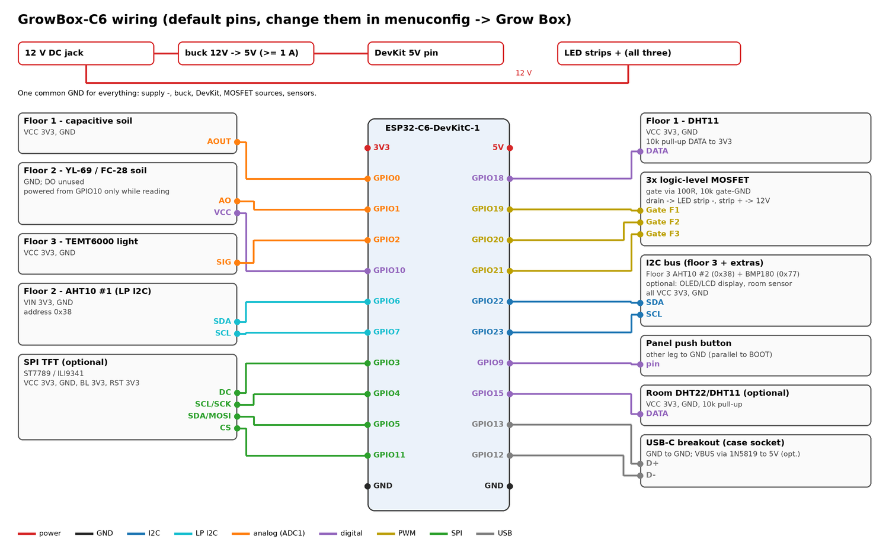

# Wiring

All pins below are the defaults. Any of them can be changed in `idf.py menuconfig` → *Grow Box*.

Use one common ground for everything: power supply −, buck converter, DevKit GND, MOSFET sources and every
sensor. All sensors run on **3.3 V**. The ESP32-C6 pins are not 5 V tolerant.

## Power

| From | To | Notes |
|---|---|---|
| 12 V supply + (DC jack) | buck converter IN+, LED strips + | Size the supply for the strips plus about 0.5 A |
| 12 V supply − | buck IN−, common GND | |
| buck OUT+ (set to 5.0 V) | DevKit **5V** pin | 1 A buck is plenty (e.g. MP1584, Mini-360, LM2596) |
| buck OUT− | DevKit GND | |

Put a fuse (about 1.25 × the strips' current) in the 12 V line close to the jack.

## LED strips (one channel per floor)

Use a **logic-level N-MOSFET** as a low-side switch, one per floor. Good choices:
- IRLZ44N, IRLB8721, or AO3400 for strips under 3 A;
- the common D4184 / AOD4184 MOSFET modules.

Avoid IRF520 modules: their gate needs about 10 V, so at 3.3 V they only half switch on and get hot.

| MOSFET pin | Connects to |
|---|---|
| Gate | GPIO19 (floor 1), GPIO20 (floor 2), GPIO21 (floor 3) through a 100 Ω resistor; 10 kΩ from gate to GND |
| Source | GND |
| Drain | LED strip − |
| (strip +) | 12 V |

The 10 kΩ pull-down keeps the light off while the ESP32 boots.

## Floor 1: DHT11 + capacitive soil sensor

| Sensor pin | ESP32 pin |
|---|---|
| DHT11 VCC | 3V3 |
| DHT11 DATA | **GPIO18**, plus 10 kΩ pull-up to 3V3 (3-pin DHT11 boards already have it) |
| DHT11 GND | GND |
| Soil (capacitive v1.2/v2.0) VCC | 3V3 |
| Soil AOUT | **GPIO0** (ADC) |
| Soil GND | GND |

## Floor 2: AHT10 #1 + YL-69 / FC-28 soil sensor

| Sensor pin | ESP32 pin |
|---|---|
| AHT10 VIN | 3V3 |
| AHT10 SDA | **GPIO6** (LP I2C, fixed pin) |
| AHT10 SCL | **GPIO7** (LP I2C, fixed pin) |
| AHT10 GND | GND |
| YL-69 module VCC | **GPIO10**. The firmware powers the probe only while measuring, so it corrodes much more slowly. |
| YL-69 module AO | **GPIO1** (ADC) |
| YL-69 module GND | GND |
| YL-69 module DO | not used |

## Floor 3: AHT10 #2 + BMP180 + TEMT6000

The AHT10 and the BMP180 share one I2C bus (addresses 0x38 and 0x77).

| Sensor pin | ESP32 pin |
|---|---|
| AHT10 / BMP180 VIN | 3V3 |
| AHT10 / BMP180 SDA | **GPIO22** |
| AHT10 / BMP180 SCL | **GPIO23** |
| AHT10 / BMP180 GND | GND |
| TEMT6000 VCC | 3V3 |
| TEMT6000 SIG | **GPIO2** (ADC) |
| TEMT6000 GND | GND |

## Cables to the floors

Each floor has two cable holes in the case: the lower one for the LED strip, the upper one for the sensors.

- **LED strip:** 2-core cable. 0.5 mm² carries up to about 3 A; use 0.75 mm² for more.
- **Sensors:** a Cat5 / Cat6 network cable (8 wires in 4 twisted pairs) is cheap and works well. Suggested pairs:

| Pair | Floor 1 | Floor 2 | Floor 3 |
|---|---|---|---|
| orange / white-orange | 3V3 / GND | 3V3 / GND | 3V3 / GND |
| green / white-green | DHT DATA / GND | SDA / GND | SDA / GND |
| blue / white-blue | soil AOUT / GND | SCL / GND | SCL / GND |
| brown / white-brown | — | soil AO / soil VCC (GPIO10) | TEMT6000 SIG / GND |

**I2C over a cable** (floors 2 and 3):
- 1–2 m works at the 100 kHz the firmware uses, with each signal twisted against GND as above.
- If readings drop out, add 4.7 kΩ pull-ups from SDA and SCL to 3V3 at the box end. Sensor boards usually have
  10 kΩ already.
- For longer runs use an I2C extender (P82B715).

**Analog soil sensors:** keep the cable under about 3 m. Calibrate the dry and wet readings with the final cable
in place (see the README).

## Room sensor (optional, next to the controller)

A temperature + humidity sensor outside the grow box. It shows up in Zigbee2MQTT / Home Assistant like a plain
Zigbee climate sensor (`temperature_room`, `humidity_room`, plus `pressure_room` for a BME280), and on the display.
Choose it in *Grow Box → Room sensor*.

The case has a small hole in the left wall for its cable. Mount the sensor outside the box, below the vents, so
the electronics don't warm it up.

| Sensor | Wiring | Notes |
|---|---|---|
| DHT22 / AM2302 | VCC 3V3, GND, DATA → **GPIO15** + 10 kΩ pull-up to 3V3 | best value; 0.1 °C / 0.1 % resolution |
| DHT11 | same as DHT22 | ±2 °C, whole degrees only |
| SHT30 / SHT31 / SHT35 | VIN 3V3, GND, SDA **GPIO22**, SCL **GPIO23** | very accurate; address 0x44 (ADDR to GND) or 0x45 |
| SHT40 / SHT41 / SHT45 | same I2C pins | very accurate; address 0x44 |
| HTU21D / SHT21 / Si7021 (GY-21) | same I2C pins | address 0x40 |
| BME280 | same I2C pins, **SDO to GND** (address 0x76) | adds air pressure. A BMP280 (purple boards are often BMP280) has no humidity. |

The I2C sensors can also go on the LP bus (GPIO6/7) instead; set that in menuconfig. AHT10 / AHT20 cannot be the
room sensor: their fixed address 0x38 is already taken on both buses by the floor 2 and floor 3 AHT10s.

## Display (optional)

| Display | Wiring |
|---|---|
| SSD1306 / SH1106 OLED, PCF8574 LCD backpack | VCC 3V3 (LCD: 5V), GND, SDA **GPIO22**, SCL **GPIO23** (shares the floor 3 bus) |
| ST7789 / ILI9341 SPI TFT | VCC 3V3, GND, SCL/SCK **GPIO4**, SDA/MOSI **GPIO5**, CS **GPIO11**, DC **GPIO3**, RST and BL to 3V3 |

A 5 V LCD backpack pulls SDA/SCL up to 5 V. Remove its two pull-up resistors (usually 4.7 kΩ near the header) or
use a level shifter.

## Button and USB-C

| Part | Wiring |
|---|---|
| 12 mm push button in the lid | one leg **GPIO9**, other leg GND (same as the DevKit's BOOT button) |
| USB-C breakout (case socket) | D+ → **GPIO13**, D− → **GPIO12**, GND → GND. VBUS → 1N5819 (stripe toward 5V) → 5V, optional. |

## Free pins left

GPIO8 (DevKit RGB LED, strapping pin), GPIO14 (not on every board), GPIO16/17 (UART0 console). If you don't use a
TFT, GPIO3/4/5/11 are free too.
